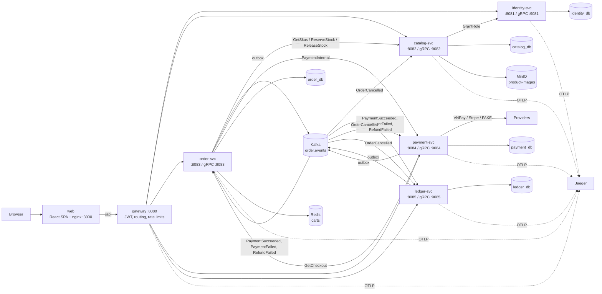

# Marketplace — Go microservices + React

A small Shopee-style multi-vendor marketplace built as a portfolio project:
many sellers open shops, buyers search and buy from several shops in one
checkout, and every order goes through a seller/buyer lifecycle. Phase 1
covers core buying and selling with cash on delivery (COD). It runs locally
with Docker Compose.

## What it does

### P1: Core marketplace

- Buyers register, log in, browse categories and search products in
  Vietnamese **with or without diacritics** ("ao thun" finds "Áo thun").
- A cart holds items from several shops; checkout splits it into **one COD
  order per shop**, all-or-nothing and idempotent.
- Any user can open a shop, becomes a seller and lists products with
  variants (SKUs) and images uploaded straight to object storage.
- Sellers confirm → ship → mark delivered; buyers confirm receipt;
  cancelling an order returns its stock.
- Stock never goes negative or oversells under concurrent checkouts.
- A checkout is traceable across gateway → order → catalog in Jaeger.

### P2: Online payment and seller payouts

- Pay by **VNPay sandbox** or **Stripe test mode** (FAKE provider by default for local dev).
- Payment goes through an escrow: captured on checkout, auto-complete after delivery (72h by default), released on completion.
- **Seller wallet** tracks available balance (after 5% commission), in-escrow (pending orders), and pending payouts.
- Payouts are settled by the ledger service's settle job (simulates a bank transfer).
- Reconciler handles dropped webhooks; refund worker handles cancellations and duplicate payments.

## Architecture



REST outside, gRPC inside, Kafka for events, one database per service. See
[docs/architecture.md](docs/architecture.md) for checkout, payment, escrow and
cancellation sequence diagrams and the consistency design, and [docs/adr](docs/adr) for
the decisions behind it.

## Tech choices

| Area | Choice |
|---|---|
| Services | Go 1.27, `net/http` (chi in identity), gRPC + protobuf (buf) |
| Data | PostgreSQL 17 (pgx, sqlc, golang-migrate), Redis 7 (carts), MinIO (images, presigned POST) |
| Messaging | Kafka 4 (KRaft) via franz-go, transactional outbox |
| Auth | RS256 JWT (golang-jwt) verified by the gateway via JWKS; rotating refresh tokens in HttpOnly cookies |
| Observability | OpenTelemetry → Jaeger, JSON `slog` logs with request and trace ids |
| Web | React 19, Vite, TypeScript, React Router, TanStack Query, openapi-fetch (types generated from OpenAPI), Tailwind + shadcn/ui, Zod |
| Contracts | OpenAPI 3.1 (`api/openapi`), protobuf (`proto/`), JSON Schema for events (`api/events`) |
| Tests | Go testing + testify, testcontainers, kin-openapi contract checks, Vitest + MSW, Playwright |

## Quick start

Prerequisites: Docker with Compose v2, Go 1.27, Node 24, `make`, `openssl`.

```bash
git clone <this repo> marketplace && cd marketplace
make keys up-app seed
```

`make up-app` builds and starts everything. The first build downloads base
images and takes the longest (typically 3–6 minutes); later starts take
under a minute. `make seed` then creates demo data through the public API
and prints the accounts. Open http://localhost:3000.

### Demo accounts

Password for every account: `matkhau123`

| Role | Email | Name | Shop |
|---|---|---|---|
| seller | `seller1@example.test` | Lan Trần | Thời Trang Phố Cổ (`/shops/thoi-trang-pho-co`) |
| seller | `seller2@example.test` | Hùng Lê | Điện Máy Sài Gòn (`/shops/dien-may-sai-gon`) |
| seller | `seller3@example.test` | Mai Phạm | Nhà Xinh Đà Lạt (`/shops/nha-xinh-da-lat`) |
| buyer | `buyer1@example.test` | An Nguyễn | — |
| buyer | `buyer2@example.test` | Bình Hoàng | — |

The seed also places orders in every state (waiting for confirmation,
confirmed, shipping, completed, cancelled) so both order pages have content.

**P2 wallet summary** after a fresh seed:

| Seller | Available | In escrow | Pending payout |
|---|---|---|---|
| Lan Trần | 286,100 ₫ | 419,000 ₫ | 0 ₫ |
| Hùng Lê | 0 ₫ | 119,000 ₫ | 0 ₫ |
| Mai Phạm | 0 ₫ | 0 ₫ | 0 ₫ |

Seller 1 also has one settled payout from the seed data.

### Switching to the real sandboxes

By default, payments use the FAKE provider (no external dependencies). To test
with **Stripe test mode** or **VNPay sandbox**:

1. Copy credentials into `deploy/secrets/payment.env`:

   ```bash
   cp deploy/secrets/payment.env.example deploy/secrets/payment.env
   # Edit and fill in: STRIPE_SECRET_KEY, STRIPE_WEBHOOK_SECRET, VNPAY_* variables
   ```

2. Set `PROVIDER_VNPAY=vnpay` and/or `PROVIDER_STRIPE=stripe` in the shell or `deploy/.env`:

   ```bash
   PROVIDER_STRIPE=stripe PROVIDER_VNPAY=vnpay make up-app
   # or export them, then: make up-app
   ```

For step-by-step instructions and a verification checklist, see
[docs/payments-sandbox.md](docs/payments-sandbox.md).

**Note:** `make e2e` restarts the stack with fast timers. A later `make up-app`
restores the defaults.

### URLs

| What | URL |
|---|---|
| Web app | http://localhost:3000 |
| Gateway (REST API) | http://localhost:8080 |
| Jaeger UI | http://localhost:16686 |
| MinIO console | http://localhost:9001 (`minioadmin` / `minioadmin`) |

### A two-minute demo

1. Log in as `buyer1@example.test`, search **ao thun** and add a T-shirt;
   search **tai nghe** and add headphones from another shop.
2. Check out: you get two orders, one per shop.
3. Log in as `seller1@example.test`, open the seller center → *Đơn hàng*, and
   confirm and ship the new order.
4. Open Jaeger, pick service `gateway` and find the most recent trace with the
   most spans: the checkout spans gateway, order and catalog (`ReserveStock`).

## Running tests

| Command | What runs |
|---|---|
| `make test` | Go unit + integration tests of every module (testcontainers, needs Docker) |
| `make lint` | golangci-lint, buf lint, Redocly lint |
| `make e2e` | API smoke tests and Playwright against the running stack ([e2e/README.md](e2e/README.md)) |
| `cd web && npm test` / `npm run e2e` | Web unit tests / Playwright against mocked APIs |

CI (`.github/workflows/ci.yml`) runs lint and tests per module, contract
checks, image builds, the web suite, and an `e2e` job that starts the stack,
seeds it and runs `make e2e`.

## Repository layout

| Path | Contents | Owner |
|---|---|---|
| `api/`, `proto/`, `gen/`, `pkg/`, `deploy/`, `Makefile` | Contracts, generated code, shared libraries, Compose | WS0 foundation |
| `services/identity` | Accounts, login, JWT + JWKS, refresh rotation, roles | WS1, WS1' |
| `services/catalog` | Shops, categories, products/SKUs, images, search, inventory | WS2, WS2' |
| `services/order` | Cart, checkout, order lifecycle, outbox, sweeper | WS3, WS3' |
| `services/gateway` | Routing, JWT verification, identity headers, CORS, rate limits | WS4, WS4' |
| `services/payment` | Payment attempts, provider adapters, webhooks, refunds, reconcile | WS1' (P2) |
| `services/ledger` | Double-entry ledger, escrow, seller wallet, payouts | WS2' (P2) |
| `web/` | Buyer storefront and seller center (React) | WS5, WS5' |
| `e2e/`, `docs/` | Seed, end-to-end tests, documentation | WS6, WS6' |

Design specs live in `docs/superpowers/specs/`.

## Roadmap

| Phase | Scope | Status |
|---|---|---|
| **P1** | Identity, catalog, order + cart, gateway, web | Done |
| **P2** (this) | Payment service (VNPay/Stripe sandbox), escrow, seller wallet, commission, payouts | Done |
| P3 | Reviews and ratings, notification service (email + WebSocket) | —— |
| P4 | Admin panel: moderation, categories, analytics | —— |
| P5 | Search service (Elasticsearch), buyer–seller chat, Kubernetes/Helm | —— |

## Troubleshooting

- **Port already in use** (3000, 8080, 9000, 9001, 16686): stop whatever holds
  it, or `make down` an older copy of this stack.
- **A service restarts with `no migration found for version N`**: the Postgres
  volume holds migrations from a newer branch. Check out `main`, or reset the
  data with `make down && docker volume rm marketplace_pgdata` (deletes all
  local data).
- **Tests pause for a while after `make seed`**: the gateway allows 10
  logins/registrations per minute per IP; the test clients wait for
  `Retry-After` instead of failing.
