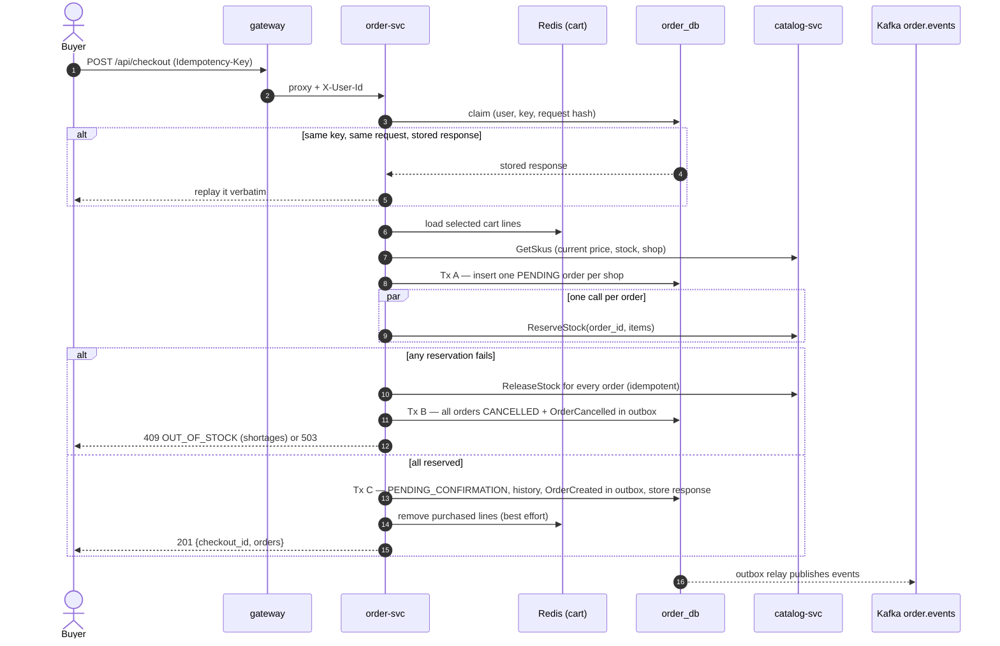
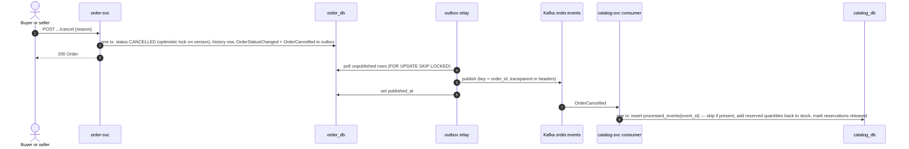
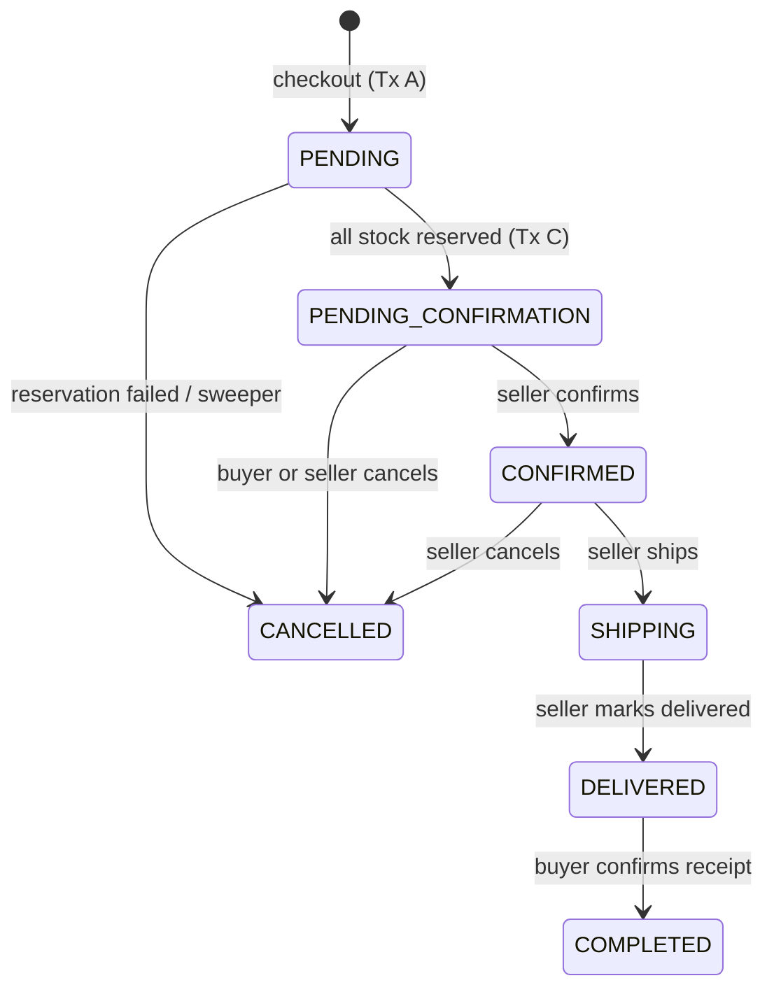

# Architecture

This document describes the Phase 1 system as built: which service owns
what, how a request travels, and how checkout and cancellation stay
consistent across services without distributed transactions. The design
specs behind it are in `docs/superpowers/specs/`; the key decisions are
recorded as ADRs in [adr/](adr).

## Services and ownership

| Service | Ports (HTTP / gRPC) | Data | Responsibilities | Talks to | Workstream |
|---|---|---|---|---|---|
| gateway | 8080 / – | none | Single public entry: routing, JWT verification (JWKS), identity headers, CORS, per-IP rate limits, 1 MB body limit, request ids, tracing | all three services over HTTP | WS4 |
| identity-svc | 8081 / 9081 | `identity_db` (users, roles, refresh tokens) | Register, login, access + refresh tokens, JWKS, `GrantRole` | – | WS1 |
| catalog-svc | 8082 / 9082 | `catalog_db` (shops, categories, products, SKUs, reservations, processed events), MinIO bucket `product-images` | Shops, products and variants, image upload URLs, search, **inventory** (the single source of truth for stock) | identity (`GrantRole`); consumes `order.events` | WS2 |
| order-svc | 8083 / 9083 | `order_db` (orders, items, history, idempotency keys, outbox), Redis (carts) | Cart, checkout (one order per shop), order state machine, event publishing, sweeper | catalog (`GetSkus`, `ReserveStock`, `ReleaseStock`); produces `order.events` | WS3 |
| web | 3000 | none | React SPA served by nginx, which proxies `/api` to the gateway | gateway | WS5 |

One Postgres instance hosts three separate databases; no service reads
another service's database. Only the gateway, web, MinIO and Jaeger publish
ports to the host, which is why services can trust the `X-User-*` headers
set by the gateway.

## A request through the gateway

1. **Request id and trace.** The gateway reuses a valid `X-Request-Id` or makes
   one, and starts (or continues, from an incoming `traceparent`) an
   OpenTelemetry span.
2. **Rate limit** per client IP: `/api/auth/login` and `/api/auth/register`
   allow 10 per minute; everything else allows 20 req/s with a burst of 40.
   The answer is `429 RATE_LIMITED` with `Retry-After`.
3. **Auth.** Incoming `X-User-Id` / `X-User-Roles` are always stripped. A bearer
   token is verified (RS256, `iss=identity`, 30 s leeway). An invalid token
   is rejected with 401 even on public routes. User routes need a token;
   seller routes (`/api/seller/*`, `/api/shops/me`) also need the `seller`
   role (403 otherwise).
4. **Proxy** to the owning service with the verified `X-User-Id` / `X-User-Roles`
   injected. Upstream errors pass through untouched; an unreachable upstream
   becomes `503 UPSTREAM_UNAVAILABLE`.

Services still enforce ownership themselves. For example, another seller's
order answers 404, so its existence is not revealed.

## Checkout

`POST /api/checkout` with an `Idempotency-Key` turns the selected cart lines
into one order per shop, or into nothing at all.

Prices come from the catalog at checkout time and are snapshotted into the
order items, together with the product name, variant and image. The
shipping fee is a flat 30,000 VND per order.

## Cancellation

A buyer can cancel an order waiting for confirmation. A seller can cancel
one that is waiting or confirmed. Stock comes back asynchronously.

The end-to-end tests check that stock is back within 5 seconds.

## Consistency approach

### Stock reservation

Catalog owns stock, and order-svc only asks for it. `ReserveStock` runs in
one transaction:
- It merges duplicate SKUs and sorts them by id, so concurrent reservations
  lock rows in the same order and cannot deadlock.
- For each SKU it runs a conditional update:
  `UPDATE skus SET stock = stock - q WHERE id = … AND active AND stock >= q`.
  No row updated means a shortage, and any shortage rolls back the whole
  reservation.
- It records `stock_reservations` rows keyed by `(order_id, sku_id)`.

Reserving the same order twice is a no-op, and so is releasing it twice, so
retries after timeouts are safe. Stock can never go negative: the database
enforces `stock >= 0`, and the update only succeeds when enough is left.

### Transactional outbox

Order changes and their events are written in the same Postgres transaction
(`outbox` table, `pkg/outbox`). A relay publishes unpublished rows to Kafka,
then marks them published. Delivery is at-least-once, so consumers are
idempotent: catalog records each handled `event_id` in `processed_events` in
the same transaction as the stock release.

### Checkout idempotency

The `(user, Idempotency-Key)` row stores a hash of the normalized request.
- The same key with the same request replays the stored response.
- The same key while the first request is still running answers 409.
- The same key with a different request answers 422 `IDEMPOTENCY_KEY_REUSED`.
- Transient failures release the key so the client can retry with it.

The web app keeps one key per checkout page visit, so double clicks and
retries never create a second set of orders.

### Sweeper

If order-svc dies between Tx A and Tx C, orders stay `PENDING`. Every
minute, a sweeper cancels orders still `PENDING` after 2 minutes
(`CHECKOUT_TIMEOUT`). It uses `FOR UPDATE SKIP LOCKED`, so replicas don't
collide, writes the cancellation events and releases the reserved stock.
The same job deletes idempotency keys older than 24 hours.

### Order state machine

Transitions are a pure domain function. Updates use optimistic locking
(`WHERE id = … AND version = …`), so a concurrent confirm and cancel cannot
both win. Every transition writes a history row and an `OrderStatusChanged`
event.

## Authentication

Identity signs 15-minute RS256 access tokens and publishes its public key as
JWKS on the internal network. The gateway fetches the JWKS at startup, and
`/readyz` stays 503 until it has. It refreshes every 5 minutes, and again on
an unknown `kid` (at most every 30 s).

Refresh tokens are random, stored hashed, and sent as an HttpOnly cookie
scoped to `/api/auth`. Every refresh rotates the token. Reusing an old one
revokes the whole token family, which is how theft is detected. Opening a
shop grants the `seller` role; the client calls `/api/auth/refresh` to get a
token that carries it. The web app keeps the access token in memory only
and restores the session on load from the refresh cookie.

## Observability

Every service exports traces over OTLP to Jaeger. The trace context
(`traceparent`) propagates over HTTP (gateway → services), over gRPC
(order → catalog, catalog → identity) and over Kafka message headers, via
the outbox row. Logs are JSON (`slog`) and carry `request_id` and
`trace_id`. An end-to-end test (`e2e/api/trace_test.go`) asserts that one
checkout produces a single trace containing gateway, order and catalog
spans, including `ReserveStock`.

## Known limitations

Deliberate P1 scope cuts: COD only, flat shipping fee, no vouchers, reviews,
notifications, admin, password reset or saved addresses.

Open issues found during integration and review, each tracked with its
owning workstream:

- **Every browser user shares one rate-limit bucket.** The gateway doesn't
  trust the web container's nginx as a proxy (`TRUSTED_PROXIES` is empty),
  so every browser user counts against one IP's limits. (WS0, finding F1)
- **The contract is missing a 401.** Public API operations don't document
  the 401 the gateway returns for an invalid token. (WS0, finding F2)
- **A lost checkout response shows an empty page.** After a network error
  on checkout, the page shows "nothing to check out" although the orders
  were placed; the retry toast recovers. (WS5, finding F3)
- **A stale seller form can overwrite stock.** A seller's product edit sets
  on-hand stock directly, so an edit form opened before a sale can
  re-inflate stock. Fixing it needs a contract change. (WS2)
- **An idempotency key can stay stuck after a crash.** If order-svc crashes
  mid-checkout, the key keeps answering "in progress" until the 24-hour
  purge; the orders themselves are cancelled by the sweeper. (WS3)
