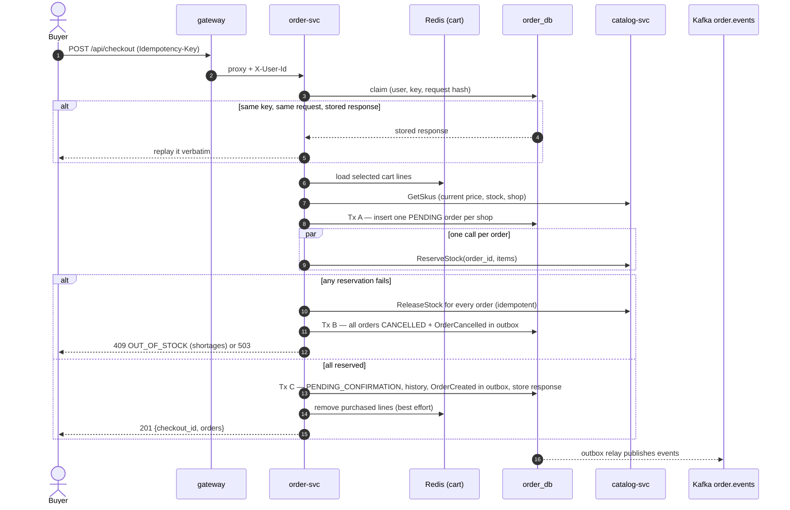
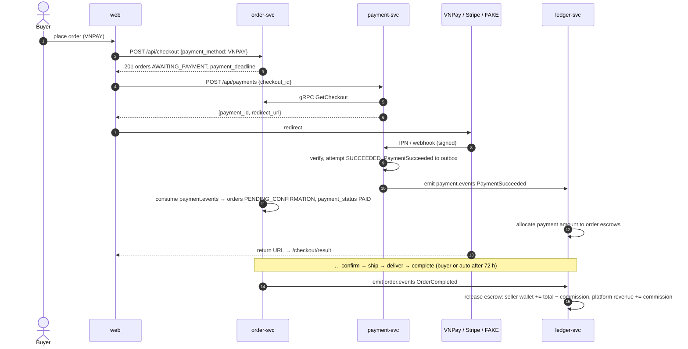
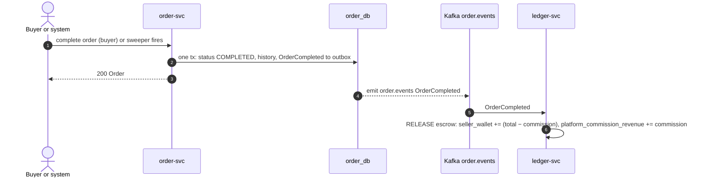
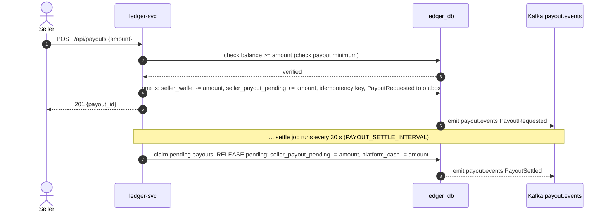
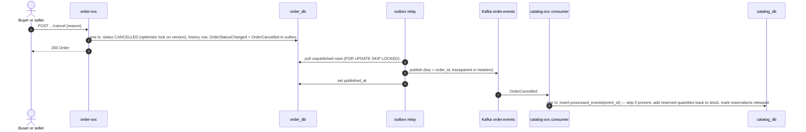
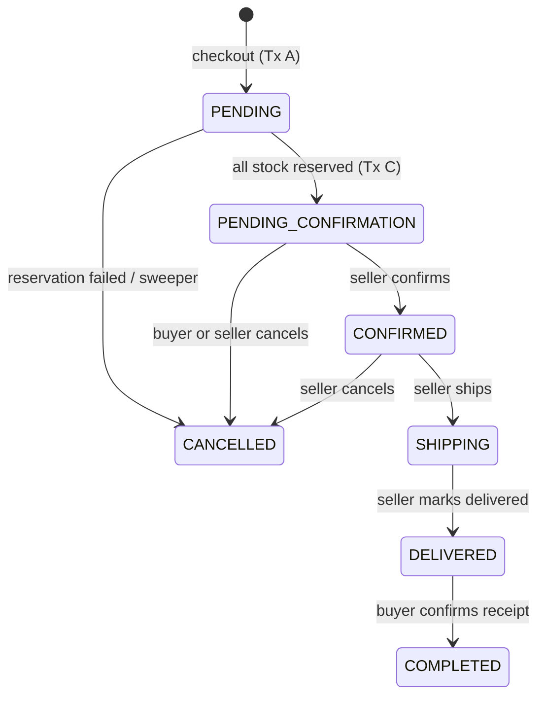

# Architecture

This document describes the marketplace system as built in Phase 1 (core
services and checkout) and Phase 2 (online payment, escrow, seller wallets,
commission and payouts). The design specs are in `docs/superpowers/specs/`;
the key decisions are recorded as ADRs in [adr/](adr).

## Services and ownership

| Service | Ports (HTTP / gRPC) | Data | Responsibilities | Talks to | Workstream |
|---|---|---|---|---|---|
| gateway | 8080 / – | none | Single public entry: routing, JWT verification (JWKS), identity headers, CORS, per-IP rate limits, 1 MB body limit, request ids, tracing | identity, catalog, order, payment, ledger over HTTP; payment callbacks | WS4 / WS4' |
| identity-svc | 8081 / 9081 | `identity_db` (users, roles, refresh tokens) | Register, login, access + refresh tokens, JWKS, `GrantRole` | – | WS1 |
| catalog-svc | 8082 / 9082 | `catalog_db` (shops, categories, products, SKUs, reservations, processed events), MinIO bucket `product-images` | Shops, products and variants, image upload URLs, search, **inventory** (the single source of truth for stock) | identity (`GrantRole`); consumes `order.events` | WS2 |
| order-svc | 8083 / 9083 | `order_db` (orders, items, history, idempotency keys, outbox, payment inbox), Redis (carts) | Cart, checkout (one order per shop, COD or online), order state machine, event publishing, sweeper (payment timeout, auto-complete), refund inbox | catalog (`GetSkus`, `ReserveStock`, `ReleaseStock`); payment (`CancelCheckoutPayments`); consumes `payment.events`, produces `order.events` | WS3 / WS3' |
| payment-svc | 8084 / 9084 | `payment_db` (payment attempts, refunds, provider events, processed events, idempotency keys) | Payment attempts (FAKE, VNPay, Stripe), callback verification (IPN, webhook, return URL), reconciliation, refund worker, order cancellation | order (`GetCheckout`); consumes `order.events`, produces `payment.events` | WS1' |
| ledger-svc | 8085 / 9085 | `ledger_db` (journal transactions, entries, escrow allocations, processed events, idempotency keys) | Double-entry ledger: provider clearing, checkout suspense, per-order escrow, seller wallet and payout-pending, commission revenue, platform cash. Balances derived from entries. Trial balance invariant enforced. | – ; consumes `payment.events` and `order.events`, produces `payout.events` | WS2' |
| web | 3000 | none | React SPA served by nginx, which proxies `/api` to the gateway | gateway | WS5 / WS5' |

One Postgres instance hosts five separate databases; no service reads
another service's database. Only the gateway, web, MinIO and Jaeger publish
ports to the host, which is why services can trust the `X-User-*` headers
set by the gateway. Payment callbacks (`/api/payments/*/`) skip authentication
and routing to a specific user, but the gateway still verifies the signature
before forwarding.

## A request through the gateway

1. **Request id and trace.** The gateway reuses a valid `X-Request-Id` or makes
   one, and starts (or continues, from an incoming `traceparent`) an
   OpenTelemetry span.
2. **Rate limit** per client IP: `/api/auth/login` and `/api/auth/register`
   allow 10 per minute; everything else allows 20 req/s with a burst of 40.
   The answer is `429 RATE_LIMITED` with `Retry-After`.
3. **Auth.** Incoming `X-User-Id` / `X-User-Roles` are always stripped. A bearer
   token is verified (RS256, `iss=identity`, 30 s leeway). An invalid token
   is rejected with 401 even on public routes. User routes need a token;
   seller routes (`/api/seller/*`, `/api/shops/me`) also need the `seller`
   role (403 otherwise).
4. **Proxy** to the owning service with the verified `X-User-Id` / `X-User-Roles`
   injected. Upstream errors pass through untouched; an unreachable upstream
   becomes `503 UPSTREAM_UNAVAILABLE`.

Services still enforce ownership themselves. For example, another seller's
order answers 404, so its existence is not revealed.

## Checkout

`POST /api/checkout` with an `Idempotency-Key` turns the selected cart lines
into one order per shop, or into nothing at all.



Prices come from the catalog at checkout time and are snapshotted into the
order items, together with the product name, variant and image. The
shipping fee is a flat 30,000 VND per order.

### Online checkout (P2)

When the buyer chooses an online payment method (VNPay or Stripe), the orders
are placed in `AWAITING_PAYMENT` instead of `PENDING_CONFIRMATION`, and a
separate step creates a payment and redirects to the provider's hosted page.
Once the provider confirms the payment asynchronously, the orders move to
`PENDING_CONFIRMATION` and the escrow is captured into the ledger.



## Refund on cancel (P2)

When a paid order is cancelled after the payment is captured, the payment-svc
creates a refund. The refund-due rule is symmetric in arrival order: whether
the capture or the cancellation arrives first, the refund is created exactly
when both facts hold.

```mermaid
sequenceDiagram
  autonumber
  actor User as Buyer or seller
  participant O as order-svc
  participant ODB as order_db
  participant P as payment-svc
  participant K as Kafka payment.events
  participant L as ledger-svc
  User->>O: POST .../cancel
  O->>ODB: one tx: status CANCELLED, history, OrderCancelled to outbox
  O-->>User: 200 Order
  ODB-->>K: emit order.events OrderCancelled (with payment_method, checkout_id)
  K->>P: OrderCancelled
  P->>P: check if capture exists; if yes, create refund, PaymentRefunded to outbox
  P->>K: emit payment.events PaymentRefunded
  K->>L: PaymentRefunded → reverse escrow allocation
  K->>O: PaymentRefunded → update payment_status to REFUNDED
```

## Escrow release on completion (P2)

When an order is completed (either by the buyer or automatically by the sweeper
after `AUTO_COMPLETE_AFTER`), the ledger releases the escrow, transferring the
funds to the seller's wallet (minus commission) and the platform's commission
revenue account.



## Payout request and settlement (P2)

A seller can request a payout up to their available wallet balance. The
ledger-svc moves the amount to the payout-pending account. A settle job then
settles it, moving it from payout-pending to platform_cash (a simulated bank
account), and publishes payout events for notifications.



## Cancellation

A buyer can cancel an order waiting for confirmation. A seller can cancel
one that is waiting or confirmed. Stock comes back asynchronously.



The end-to-end tests check that stock is back within 5 seconds.

## Consistency approach

### Stock reservation

Catalog owns stock, and order-svc only asks for it. `ReserveStock` runs in
one transaction:
- It merges duplicate SKUs and sorts them by id, so concurrent reservations
  lock rows in the same order and cannot deadlock.
- For each SKU it runs a conditional update:
  `UPDATE skus SET stock = stock - q WHERE id = … AND active AND stock >= q`.
  No row updated means a shortage, and any shortage rolls back the whole
  reservation.
- It records `stock_reservations` rows keyed by `(order_id, sku_id)`.

Reserving the same order twice is a no-op, and so is releasing it twice, so
retries after timeouts are safe. Stock can never go negative: the database
enforces `stock >= 0`, and the update only succeeds when enough is left.

### Transactional outbox

Order changes and their events are written in the same Postgres transaction
(`outbox` table, `pkg/outbox`). A relay publishes unpublished rows to Kafka,
then marks them published. Delivery is at-least-once, so consumers are
idempotent: catalog records each handled `event_id` in `processed_events` in
the same transaction as the stock release.

### Checkout idempotency

The `(user, Idempotency-Key)` row stores a hash of the normalized request.
- The same key with the same request replays the stored response.
- The same key while the first request is still running answers 409.
- The same key with a different request answers 422 `IDEMPOTENCY_KEY_REUSED`.
- Transient failures release the key so the client can retry with it.

The web app keeps one key per checkout page visit, so double clicks and
retries never create a second set of orders.

### Sweeper

If order-svc dies between Tx A and Tx C, orders stay `PENDING`. Every
minute, a sweeper cancels orders still `PENDING` after 2 minutes
(`PENDING_TIMEOUT`, cancel reason `CHECKOUT_TIMEOUT`). It uses `FOR UPDATE SKIP LOCKED`, so replicas don't
collide, writes the cancellation events and releases the reserved stock.
The same job deletes idempotency keys older than 24 hours.

### Order state machine



Transitions are a pure domain function. Updates use optimistic locking
(`WHERE id = … AND version = …`), so a concurrent confirm and cancel cannot
both win. Every transition writes a history row and an `OrderStatusChanged`
event.

## Authentication

Identity signs 15-minute RS256 access tokens and publishes its public key as
JWKS on the internal network. The gateway fetches the JWKS at startup, and
`/readyz` stays 503 until it has. It refreshes every 5 minutes, and again on
an unknown `kid` (at most every 30 s).

Refresh tokens are random, stored hashed, and sent as an HttpOnly cookie
scoped to `/api/auth`. Every refresh rotates the token. Reusing an old one
revokes the whole token family, which is how theft is detected. Opening a
shop grants the `seller` role; the client calls `/api/auth/refresh` to get a
token that carries it. The web app keeps the access token in memory only
and restores the session on load from the refresh cookie.

## Observability

Every service exports traces over OTLP to Jaeger. The trace context
(`traceparent`) propagates over HTTP (gateway → services), over gRPC
(order → catalog, catalog → identity) and over Kafka message headers, via
the outbox row. Logs are JSON (`slog`) and carry `request_id` and
`trace_id`. An end-to-end test (`e2e/api/trace_test.go`) asserts that one
checkout produces a single trace containing gateway, order and catalog
spans, including `ReserveStock`.

## Money (P2)

The marketplace ledger is a double-entry, append-only journal owned by
ledger-svc. Every transaction balances to zero (sum of debits = sum of credits).
Balances are derived by summing entries; no balance column is stored.

### Chart of accounts

| Account Code | Type | Scope | Purpose |
|---|---|---|---|
| `psp_clearing:{provider}` | Asset | Global | Money at a provider (VNPay, Stripe, FAKE) waiting to be received |
| `checkout_suspense:{checkoutID}` | Liability | Checkout | A received payment not yet allocated to orders |
| `escrow:{orderID}` | Liability | Order (seller) | One order's share held until the order completes or is refunded |
| `seller_wallet:{sellerID}` | Liability | Seller | A seller's available balance (sum of completed orders' net credit, minus any pending payouts) |
| `seller_payout_pending:{sellerID}` | Liability | Seller | Requested payouts waiting for settlement |
| `platform_commission_revenue` | Revenue | Global | The platform's commission income from online orders |
| `platform_cash` | Asset | Global | Simulated bank account (goes negative as payouts settle; P2 does not model provider settlement) |

### Invariants

1. **Every transaction balances.** A deferred constraint trigger
   `entries_balanced` checks that every transaction's entries sum to zero at
   commit. This is also validated in code by `domain.Journal.Validate`.
2. **Append-only.** Triggers reject `UPDATE`, `DELETE`, and `TRUNCATE` on
   `journal_transactions` and `entries`. A correction is made with a reversing
   transaction (ADR-0006).
3. **No liability in debit.** A posting that debits a liability account (seller
   wallet, escrow, suspense) locks that account's row, recomputes its balance
   from entries, and refuses the posting if the result would be negative. This
   makes "payout ≤ available" atomic and prevents an escrow from being both
   released and refunded.
4. **Idempotent postings.** Each posting is keyed by a business idempotency key
   (`pay:{payment_id}`, `capture:{checkout_id}:{order_id}`, `release:{order_id}`,
   `refund:{refund_id}`, `payout_request:{payout_id}`, `payout_settle:{payout_id}`).
   A duplicate event posts once.

### Trial balance

The trial balance is a command that sums entries by type and reports:
- `balances_by_type`: Asset, Liability, and Revenue totals (should sum to zero)
- `unbalanced_transactions`: any transaction whose entries don't sum to zero
- `liabilities_in_debit`: any liability account with a positive balance (should be empty)

The e2e suite runs it after every scenario:

```bash
docker compose exec ledger /server trial-balance
```

It exits 0 if the ledger is consistent and 1 otherwise. This is documented
in `services/ledger/README.md` and ADRs 0006 and 0007.

## Known limitations

Deliberate P1 scope cuts: COD only, flat shipping fee, no vouchers, reviews,
notifications, admin, password reset or saved addresses.

P2 scope: no partial refunds, no refunds after order completion, no reviews,
no saved cards, no multiple currencies, no admin UI for the ledger, no real
bank payouts or provider settlement reconciliation.

Known P2 limitations:

- **VNPay refund RC 00 is final.** The refund API has no per-request status
  to poll, so a refund answered RC 00 is accepted without a follow-up.
- **FAKE is not a security boundary.** Its webhook is signed with a shared
  dev secret and its hooks are open; never expose a FAKE-enabled instance
  to real users.
- **Trial balance is a full scan.** Reading every entry to check consistency
  is fine at portfolio scale, but snapshots can be added later if needed.

Open issues from P1, each tracked with its owning workstream:

- **A stale seller form can overwrite stock.** A seller's product edit sets
  on-hand stock directly, so an edit form opened before a sale can
  re-inflate stock. Fixing it needs a contract change. (WS2)
- **An idempotency key can stay stuck after a crash.** If order-svc crashes
  mid-checkout, the key keeps answering "in progress" until the 24-hour
  purge; the orders themselves are cancelled by the sweeper. (WS3)

Integration testing also found and fixed three bugs, now covered by
regression tests (see [e2e/README.md](../e2e/README.md#findings)):
- browser traffic shared one rate-limit bucket (the gateway now trusts only
  the web container as a proxy);
- the contract lacked the 401 for invalid tokens on public routes;
- a lost checkout response showed an empty checkout page.
