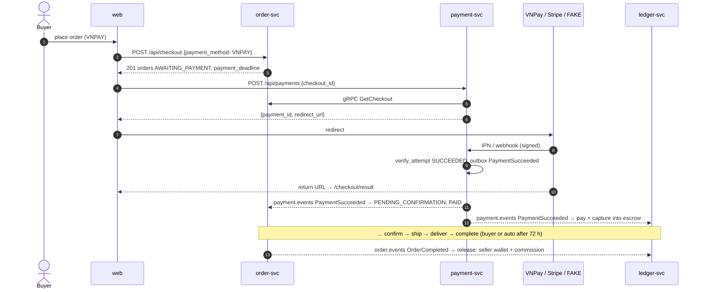

# Marketplace P2: Overview and Workstreams

> This is the umbrella spec for Phase 2. Each workstream has its own spec in this folder (`2026-09-29-marketplace-p2-ws*.md`). P1 is merged on `main`. Its specs are `2026-09-28-marketplace-p1-*.md`, and the system as built is described in `docs/architecture.md` and `docs/adr/0001`–`0005`. Workstreams are named with a prime (WS0'–WS6') so they can't be confused with the P1 workstreams.

## 1. Goal

P2 adds **online payment, escrow, seller wallets and commission** to the P1 marketplace, and keeps cash on delivery (COD) as it is.

**Decided by the user:**
1. Both providers ship in P2: **VNPay sandbox** and **Stripe test mode**, behind one provider port in payment-svc. At checkout the buyer picks `COD | VNPAY | STRIPE`. COD keeps the P1 flow.
2. **Escrow:** paid money is held until the order is `COMPLETED`. If the buyer doesn't confirm, order-svc auto-completes the order `AUTO_COMPLETE_AFTER` (default 72 h) after `DELIVERED`. ledger-svc releases the escrow on `OrderCompleted`.
3. **The ledger is its own service** (ledger-svc, with its own database). It is a double-entry, append-only ledger, and balances are always derived. payment-svc holds no balances.
4. **One payment per checkout.** The buyer pays once for all the orders of a checkout (one order per shop). The ledger allocates the amount to each order's escrow. Cancelling one paid order refunds that order's share, which is a partial refund at the provider.
5. **Commission** applies only to online orders. It is a flat, configurable rate (`COMMISSION_RATE_BPS`, default 500 = 5%) of the order **subtotal**, snapshotted on the order at checkout. The seller keeps the shipping fee. COD orders never touch the ledger.
6. **Refunds** are full refunds of an order, issued when a paid order is cancelled. Partial refunds of an order are out of scope.
7. **Payout:** the seller requests a withdrawal, and a simulated job settles it. There is no real bank transfer.
8. **Failed payment:** the orders stay `AWAITING_PAYMENT`, and the buyer may pay again until the payment deadline. Only one attempt is open at a time. If a buyer is ever charged twice, the second charge is refunded automatically.
9. **The FAKE provider** has a simulated hosted page and a signed asynchronous callback. It is the default in local dev, CI and e2e, because CI can't reach the VNPay or Stripe sandboxes. The buyer still picks `VNPAY` or `STRIPE`, and each method is served either by its real adapter or by FAKE, chosen per method through environment variables (`PROVIDER_VNPAY`, `PROVIDER_STRIPE`, default `fake`). The real sandboxes are opt-in.

**P2 success criteria.** After `make up-app && make seed` (FAKE provider):
1. A buyer checks out a cart from two shops with `VNPAY` or `STRIPE`, is redirected to the provider page (the FAKE page in CI), pays once, and sees both orders move to `PENDING_CONFIRMATION` with payment status `PAID`.
2. A payment that fails, or is abandoned, can be retried until the deadline. After the deadline the orders are cancelled and their stock comes back.
3. When a paid order is cancelled, its share is refunded, and the refund is visible on the order (`REFUNDED`) and in the ledger.
4. When a paid order completes, either by the buyer or automatically after `AUTO_COMPLETE_AFTER`, the seller's wallet grows by `total − commission`, and platform revenue grows by the commission.
5. A seller requests a payout for up to the available balance and sees it settle. A request above the balance is rejected with `INSUFFICIENT_FUNDS`.
6. Duplicate and out-of-order provider callbacks never double-charge, double-refund or double-credit. The ledger's trial balance is always zero, and it is checked after every e2e scenario.
7. The same checkout also works manually against the real VNPay sandbox and Stripe test mode (a documented, non-CI check).

## 2. Roadmap position

| Phase | Scope |
|---|---|
| P1 (done) | Identity, Catalog, Order (+ cart), Gateway, Web |
| **P1.5** | A separate session fixes the P1 follow-ups that P2 depends on (§7) |
| **P2** | payment-svc (VNPay, Stripe, FAKE), ledger-svc (escrow, wallets, commission, payouts), order and web changes |
| P3 | Reviews and ratings; Notification service (email and WebSocket), which will consume `payment.events` and `payout.events` |

Out of scope for P2:
- partial refunds of an order;
- refunds after `COMPLETED` (disputes and returns);
- vouchers;
- real bank payouts and reconciliation of provider settlement into `platform_cash`;
- multiple currencies;
- an admin UI for the ledger (P4);
- saved cards;
- 3-D Secure flows beyond what Stripe's hosted page does.

## 3. Architecture

```
Browser ─► web :3000 ─/api─► gateway :8080
                               ├─► identity-svc :8081/9081 ─► identity_db
                               ├─► catalog-svc  :8082/9082 ─► catalog_db, MinIO
                               ├─► order-svc    :8083/9083 ─► order_db, Redis
                               ├─► payment-svc  :8084/9084 ─► payment_db        (new)
                               └─► ledger-svc   :8085/9085 ─► ledger_db         (new)

payment-svc ──gRPC OrderInternal.GetCheckout──────────────► order-svc
order-svc   ──gRPC PaymentInternal.CancelCheckoutPayments─► payment-svc
payment-svc ──HTTPS──► VNPay sandbox / Stripe API / FAKE (in-process)
VNPay IPN, Stripe webhook, FAKE callback ──► gateway ──► payment-svc

Kafka (outbox, ADR-0003):
  order.events   order-svc   ─► catalog (OrderCancelled), payment (OrderCancelled), ledger (OrderCompleted)
  payment.events payment-svc ─► order (PaymentSucceeded, PaymentRefunded), ledger (PaymentSucceeded, PaymentRefunded)
  payout.events  ledger-svc  ─► (no consumer in P2; P3 notifications)
```

The online checkout, end to end:



## 4. Shared conventions (extends P1 WS0 §3)

- **Money.** VND is an `int64` with no decimals, everywhere. VNPay's `vnp_Amount` is `amount × 100`. Stripe treats VND as a **zero-decimal currency**, so its `amount` is the VND value itself. No money is ever a float.
- **Commission:** `commission_amount = floor(subtotal × COMMISSION_RATE_BPS / 10000)`, computed once at checkout and stored. It is never recomputed.
- **Ports:** payment 8084 (HTTP) and 9084 (gRPC); ledger 8085 and 9085. Only the gateway, web, MinIO and Jaeger publish ports to the host (P1 rule).
- **Events.** P1 envelope, outbox relay and idempotent consumers (ADR-0003). New topics: `payment.events` (key `checkout_id`) and `payout.events` (key `seller_user_id`), 3 partitions each. The full catalogue is in the WS0' spec §5.
- **Consumers** record `processed_events(event_id)` in the same transaction as their effect. ledger-svc also keys every posting by a business `idempotency_key` (ADR-0006).
- **New error code:** `INSUFFICIENT_FUNDS` (409). A checkout that can't be paid (wrong state, deadline passed) answers `INVALID_STATE_TRANSITION` (409). Provider outages answer `UPSTREAM_UNAVAILABLE` (503).
- **Secrets.** Provider credentials live in `deploy/secrets/payment.env` (gitignored). `deploy/secrets/payment.env.example` documents them. `PAYMENT_PROVIDERS` defaults to `fake`.
- Everything else is as in P1: IDs, time, JSON style, pagination, error envelope, internal headers, `/healthz` and `/readyz`, and migrations on startup.

## 5. Workstreams

```
P1.5 fixes (separate session) ─┐
WS0' Contracts & Foundation ───┴─┬── WS1' payment ──┐
                                 ├── WS2' ledger  ──┤
                                 ├── WS3' order   ──┼──► WS6' Integration & E2E
                                 ├── WS4' gateway ──┤
                                 └── WS5' web     ──┘
```

| WS | Spec | Owns | Mocks during development | Ports |
|---|---|---|---|---|
| WS0' | `…-p2-ws0-contracts.md` | `api/`, `proto/`, `gen/`, `pkg/`, `go.work`, `Makefile`, `.github/`, `deploy/`, `.gitignore`, skeletons `services/payment`, `services/ledger` | — | — |
| WS1' | `…-p2-ws1-payment.md` | `services/payment/` | fake `OrderInternal` (bufconn), httptest VNPay/Stripe stubs | 8084/9084 |
| WS2' | `…-p2-ws2-ledger.md` | `services/ledger/` | events produced by test helpers | 8085/9085 |
| WS3' | `…-p2-ws3-order.md` | `services/order/` | fake `PaymentInternal` (bufconn) | 8083/9083 |
| WS4' | `…-p2-ws4-gateway.md` | `services/gateway/` | httptest upstreams | 8080 |
| WS5' | `…-p2-ws5-web.md` | `web/` | MSW handlers from OpenAPI | 3000 |
| WS6' | `…-p2-ws6-integration.md` | `e2e/`, `docs/` (except `docs/superpowers/`), `README.md`; after WS1'–WS5' merge, also the `seed`/`e2e` Makefile targets and the CI `e2e` job | — (real stack, FAKE provider) | — |

**Coordination rules** (the P1 rules still apply):
- WS0' merges first. WS1'–WS5' then run in parallel. Each one edits **only** the directories it owns and depends on contracts, never on another workstream's code.
- **Shared files belong to WS0' alone:** `deploy/docker-compose*.yml`, `deploy/postgres/*`, `deploy/secrets/*.example`, `go.work` and `go.work.sum`, `Makefile`, `.github/workflows/ci.yml`, `.gitignore`.
  - A workstream that needs a change to one of them, such as a new environment variable in compose, asks for a small WS0' follow-up PR. It never edits the file in its own branch.
  - Every service's compose environment is specified in full by the WS0' spec §8, so none should be needed.
- Contract changes (`api/`, `proto/`, `pkg/`) go through a dedicated PR to `main`. `buf breaking` must pass. In-flight workstreams rebase afterwards.
- WS6' starts once WS1'–WS4' have merged. WS5' may merge before or during WS6'.

## 6. Decisions recorded as ADRs

- `docs/adr/0006-double-entry-ledger-service.md`: why the ledger is its own double-entry, append-only service with derived balances.
- `docs/adr/0007-escrow-release-policy.md`: hold until `COMPLETED`, auto-complete after delivery, and the rule "refund when captured and cancelled".
- `docs/adr/0008-payment-provider-port-and-webhooks.md`: one provider port, signature verification, the webhook inbox, "fetch, don't trust" for out-of-order events, return URL versus IPN, and reconciliation.

## 7. P1 follow-ups that P2 depends on (fixed in P1.5, not re-specified here)

These items are tracked in the P1 follow-up notes and fixed by a separate P1.5 session **before WS3' and WS5' start**. P2 specs assume they are done.

| Source | Item | Why P2 needs it |
|---|---|---|
| WS3 (order) | An idempotency row orphaned by a crash answers 409 "in progress" until the 24 h purge | Online checkout adds a second step. A buyer who retries checkout after a crash must not be locked out for a day. |
| WS3 (order) | No overall deadline on the `WithoutCancel` checkout context | A hung checkout would hold orders in `PENDING` while the payment deadline is running |
| WS3 (order) | Tx B losing the sweeper race answers 409 `CONFLICT` instead of `OUT_OF_STOCK` | The web maps these codes to different messages on the new payment path |
| WS5 (web/contract) | `CartShop.shipping_fee` is missing, so web uses the constant `SHIPPING_FEE_FLAT` | The online amount shown before redirect must equal what the server charges |
| WS5 (web/contract) | `Order.shop` has no `slug` | The wallet entries and payout pages link orders to shops |
| WS2 (catalog) | A seller PATCH overwrites on-hand stock; reserve-after-release tombstone | Payment-timeout cancellations release stock far more often than P1 did |
| WS6 (e2e) | The CI e2e job has never run on GitHub; seed doesn't resume a partial run | WS6' extends that job and seed |

P1 ADR 0004's known gap (the stock overwrite) is the same item as the WS2 row above.
